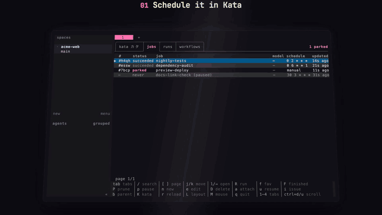
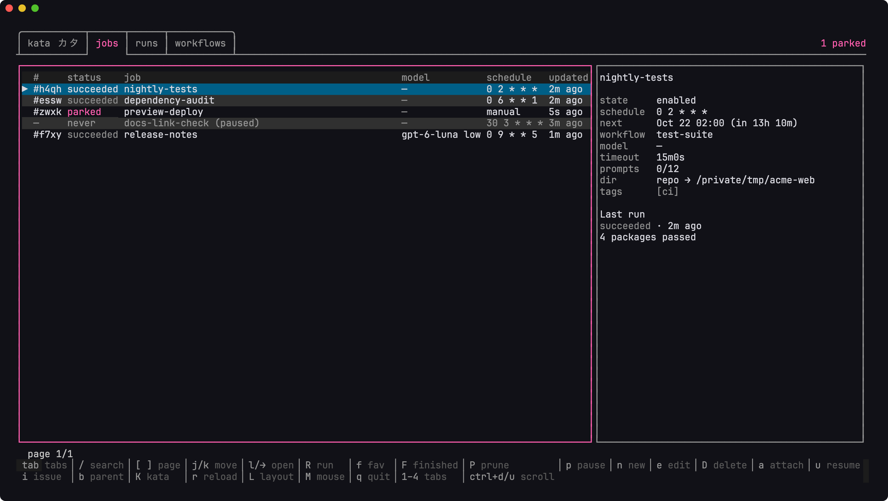
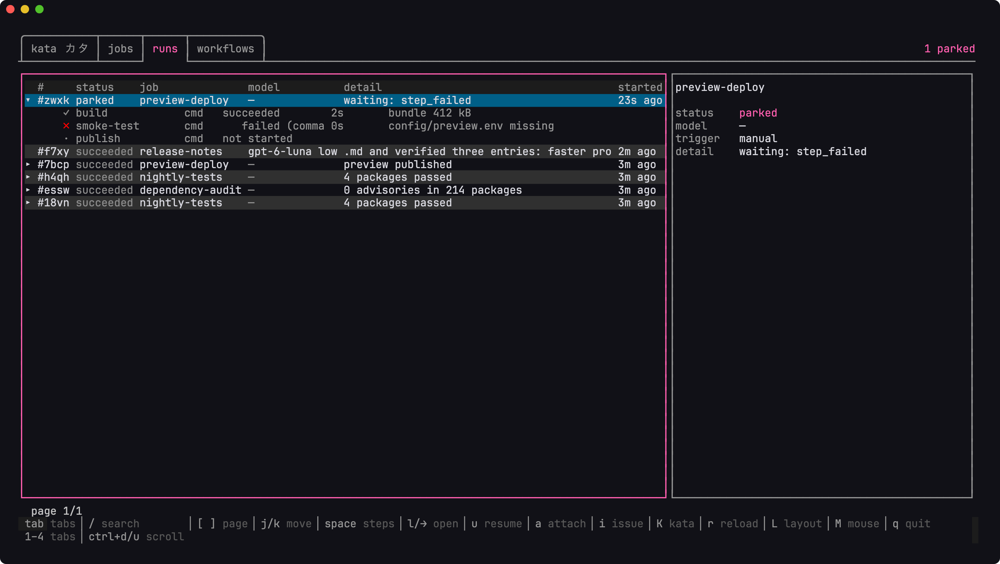
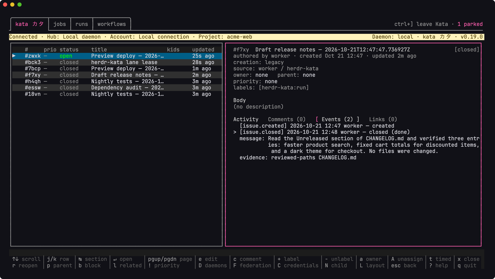

# herdr-kata

A [Herdr](https://github.com/herdrdev/herdr) plugin that runs
[Kata](https://github.com/kenn-io/kata) cron jobs and workflows as Herdr agents
and commands, and reports every run back to Kata. Kata owns the definitions,
schedules, issues and evidence.

[](https://github.com/salmonumbrella/herdr-kata/releases/download/v0.1.0/demo.mp4)

## Requirements

- Linux or macOS with Herdr 0.9.5 or later.
- Kata 0.19.0 or later.

## Install

```sh
herdr plugin install salmonumbrella/herdr-kata --yes
```

From a source checkout:

```sh
go build -trimpath -o ./bin/herdr-kata ./cmd/herdr-kata
herdr plugin link "$PWD"
```

## First run

Write `config.toml` in the directory that
`herdr plugin config-dir kata` prints: one Herdr session,
one unique executor label, one or more Kata projects, one agent profile.
Paths are absolute and unknown keys are rejected.

```toml
session = "work"
executor = "work-runtime"

[kata]
bin = "/usr/local/bin/kata"

[[projects]]
name = "example-project"
actor = "worker"

[checkouts]
repo = "/srv/projects/example"

[profiles.default]
kind = "codex"
args = []
```

Then, in that Herdr session:

```sh
herdr-kata up
herdr-kata status
herdr-kata doctor
herdr-kata run <job-uid> --wait
herdr-kata tui
```

`up` starts or upgrades the runtime, `doctor` says what is wrong and how to
fix it, `run` submits a job through the normal readiness and capacity rules,
and `tui` is the board. The [quickstart](docs/get-started/quickstart.md) walks
a real prompt job end to end, from the Kata job definition to the issue it
closes with evidence.

## The board

`herdr-kata tui` opens the board. Jobs lists each definition with its model,
schedule and latest run; in a pane of at least 140×36 an inspector shows
the selected row.



Runs shows every retained run. A workflow with `on_failure: "park"` holds the
run when a step fails; fix the cause and press `u` to resume it.



The leading Kata tab runs your `kata tui` inside the board, and `i` opens a
run's issue there. This one closed `done` with the agent's summary and its
evidence.



Normal child issues can also request execution explicitly through
[`herdr_kata.request`](docs/reference/kata-adapter.md#explicit-issue-requests)
and the existing runtime inbox. Ordinary notifications remain non-executable.

## Limits

Native cron session reports retain up to 64 unique Codex/Claude sessions and
mark missing or excess sessions incomplete. They require a Kata CLI and
daemon advertising session support; older combinations still report
outcomes. See [native session links](docs/reference/reporting.md#native-session-links).

Retiring a removed lane needs its original Kata route and credentials, and
resolved identities for configured projects; see
[Remove a project](docs/guide/multiple-projects.md#remove-a-project).

Existing installs must follow the [plugin ID upgrade procedure](docs/get-started/install.md#upgrade-from-the-old-plugin-id)
for `kata`, including stopping the old runtime before its config/state move.
Keep the legacy aliases for saved artifact paths. The bare ID
could collide with a future official plugin; check the install source before
confirming replacement.

Unfiltered run history scans retained local journals. Large stores take longer;
see [history selection and scan limits](docs/reference/cli.md#run-and-inspect).

Use the current installed build for [status and operator controls](docs/reference/cli.md#operator-controls).
Older builds cannot read the new request-result identity fields.

Explicit issue requests permit one automatic admission per child UID, so a
scheduled child runs once on its date and a later reschedule never re-runs it. A
permanent receipt without its matching local journal holds execution. Competing
workers must share one authoritative Kata service; independent writable
replicas cannot supply global CAS exclusion.

A project with no job definitions checks its route only every few minutes, so
opening its Kata tab can refuse until the next check; see
[Embedded Kata](docs/reference/tui.md#embedded-kata).

## Development

`make check` runs lint and the race tests. `make test-crash`, `make test-kata`
and `make test-kata-children` are the recovery and Kata suites.
[Contributing](docs/development/contributing.md) maps the repository and lists
every check and its requirements. Tool pins live in `mise.toml`; conventions
and commit rules are in [AGENTS.md](AGENTS.md).

## Version and license

`herdr-kata version` prints the installed version; changes are in
[docs/changelog.md](docs/changelog.md). MIT, see [LICENSE](LICENSE).
