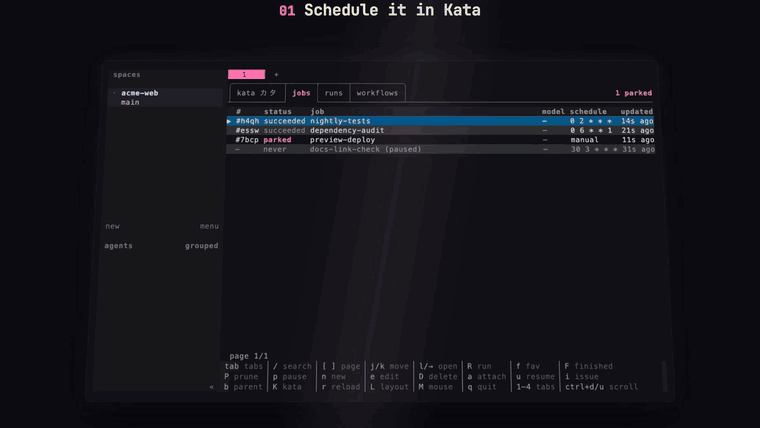

# herdr-kata

A headless worker that runs [Kata](https://github.com/kenn-io/kata) jobs as
agents and commands, or by waking an existing session, on [herdr-core](https://github.com/herdrdev/herdr-core)
(`hc`), and reports every run back to Kata.

[](https://github.com/salmonumbrella/herdr-kata/releases/download/v0.1.0/demo.mp4)

## How it works

The worker adopts advertised [fleet capabilities](docs/operations.md#fleet-capabilities) per project.

There is nothing to look at in herdr-kata itself. You work in Kata:

- Create, edit, enable and run jobs with `kata cron` or in `kata tui`'s Jobs
  tab.
- Watch runs and read their results in `kata tui`'s Runs tab, or on the
  issue each run reports to.

herdr-kata runs in the background as one worker terminal in an hc session.
It reads job definitions from Kata, launches each due run as a fresh agent
or command terminal in the same session, keeps a local journal so a restart
never launches the same work twice, and records the outcome in Kata. If the
Herdr app is connected to that session, job terminals show up there like
any other terminal and you can watch or attach to one while it works.

v2 replaces the old Herdr plugin. It has no plugin manifest, panes or board
of its own; `kata tui` is the interface. Its configuration and state start
fresh and are not compatible with v1.

## Requirements

- A [release binary](https://github.com/salmonumbrella/herdr-kata/releases/latest)
  for macOS or Linux, or Go 1.27 to build: `make build` writes `bin/herdr-kata`.
- hc 0.1.15 or newer.
- Kata 0.20.0 or newer and an authenticated daemon catalog entry.
- Linux or macOS, an executable agent profile and a local checkout.

## Configuration

Save `$XDG_CONFIG_HOME/herdr-kata/config.toml` (default
`~/.config/herdr-kata/config.toml`). All filesystem paths are absolute.
Invalid `[[projects]]` entries are quarantined so other projects keep running;
unknown keys outside project entries and invalid global settings reject the file.
`--config` and `--state` select explicit paths. See
[quarantine recovery](docs/operations.md#quarantined-projects).

```toml
executor = "work-runtime"
hc_session = "default"
hc_bin = "/usr/local/bin/hc"

[kata]
bin = "/usr/local/bin/kata"
daemon = "hub"

[kata.env]
KATA_HOME = "/srv/kata-home"

[[projects]]
name = "example-project"
actor = "worker"
commands = false
max_active_runs = 1
default_checkout = "example-project"
default_agent = "default"

[checkouts]
example-project = "/srv/projects/example"

[profiles.default]
argv = ["codex", "--no-daemon"]
model_flag = "--model"

[limits]
default_timeout = "2h"
max_timeout = "24h"
max_active_runs = 4
unset_env = []
```

`hc_bin` and `kata.bin` default to PATH lookups, resolved once when loading
the config. `hc_session` defaults to `default`. Kata environment overrides
allow only `KATA_SERVER`, `KATA_HOME` and `XDG_*`; never put tokens in config.
State defaults to `$XDG_STATE_HOME/herdr-kata/`.

## Create a job

Once the project has defaults configured, an enabled job needs no adapter fields:

```sh
kata --project example-project cron job create --file - <<'JSON'
{
  "name": "Review project work",
  "definition": {
    "version": 1,
    "kind": "job",
    "enabled": true,
    "trigger": {"kind": "cron", "cron": "0 9 * * *", "timezone": "UTC"},
    "action": {"kind": "execute", "prompt": "Review the project and record findings."},
    "issue": {"kind": "per-run", "title": "Project review"},
    "overlap": "forbid",
    "catchup": "latest"
  }
}
JSON
```

The wire default for `enabled` is false. Owned unsupported definitions appear
as failed runs in Kata with `reason: unsupported`. See [Jobs](docs/jobs.md)
for resolution rules and [Operations](docs/operations.md) for the single-runtime
operating condition.

## Running work

Start the worker with `herdr-kata up` and check its execution environment with
`herdr-kata doctor`. `herdr-kata run <job-uid> --input <text>` queues a local
request and waits for the worker's decision. Use `herdr-kata logs <run-uid>` to read output and
`herdr-kata release <run-uid>` to free a held run's slot and overlap gate.
`herdr-kata stop` stops the worker; job terminals continue for recovery.

## Starting at login

Run `herdr-kata service install` from the shell where `herdr-kata up` works.
See [Install](docs/install.md#start-at-login) for login startup, refresh and removal.
